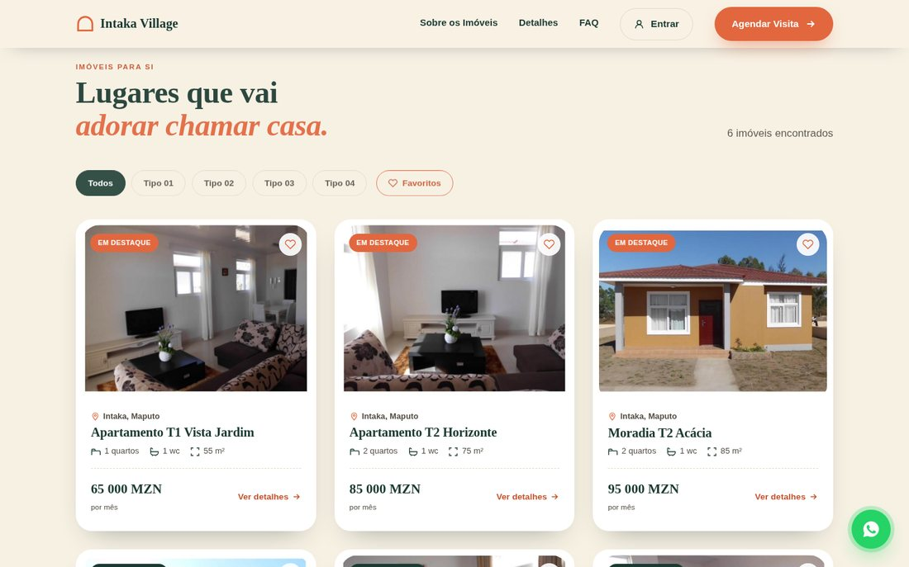
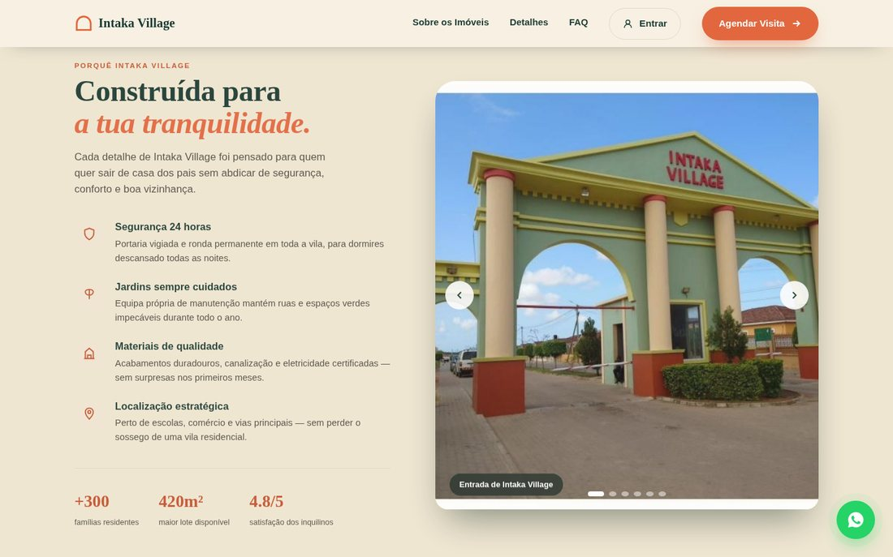
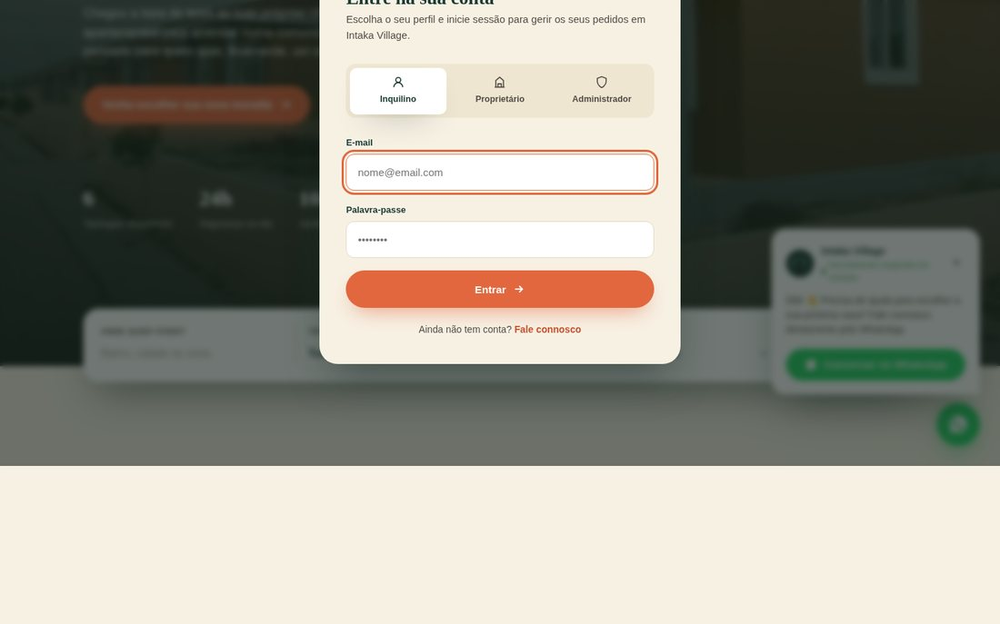
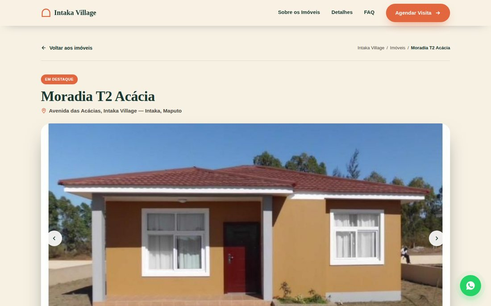
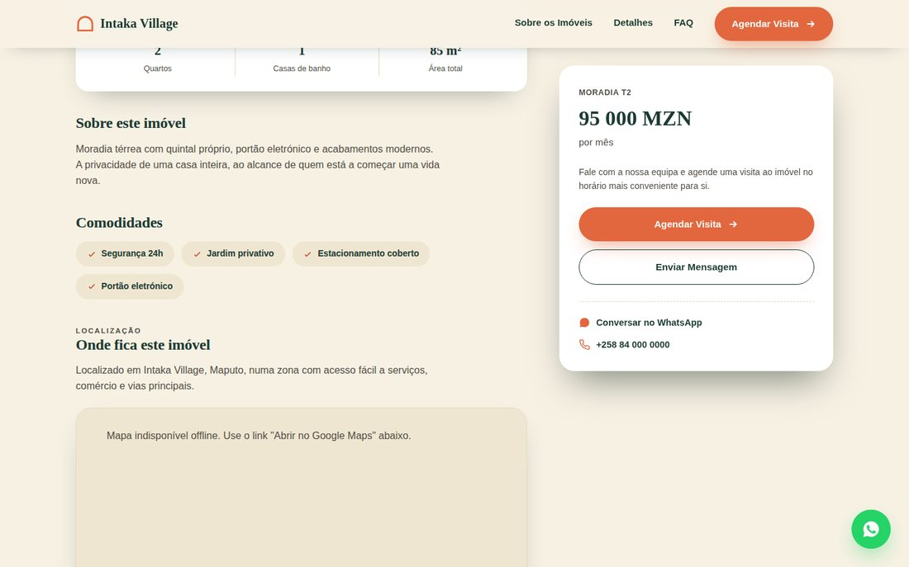
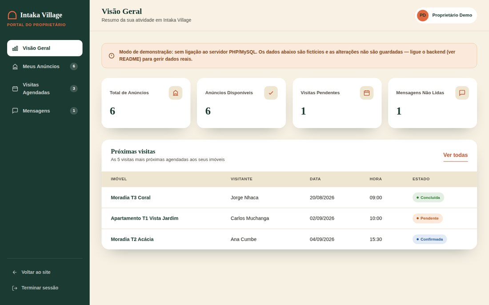
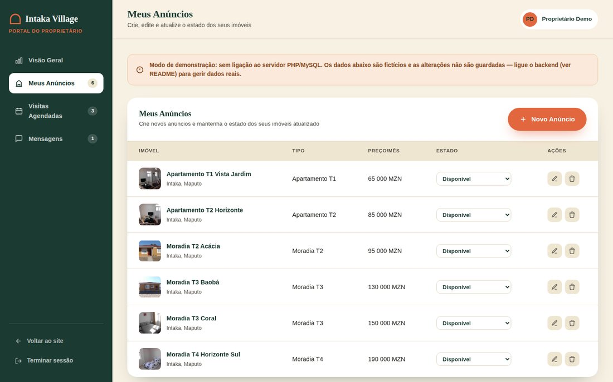
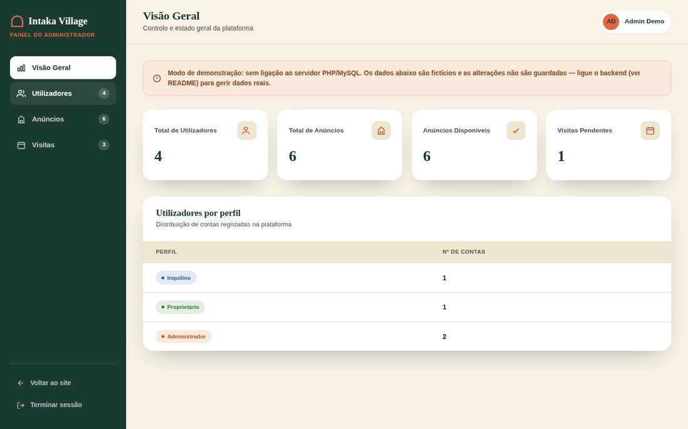
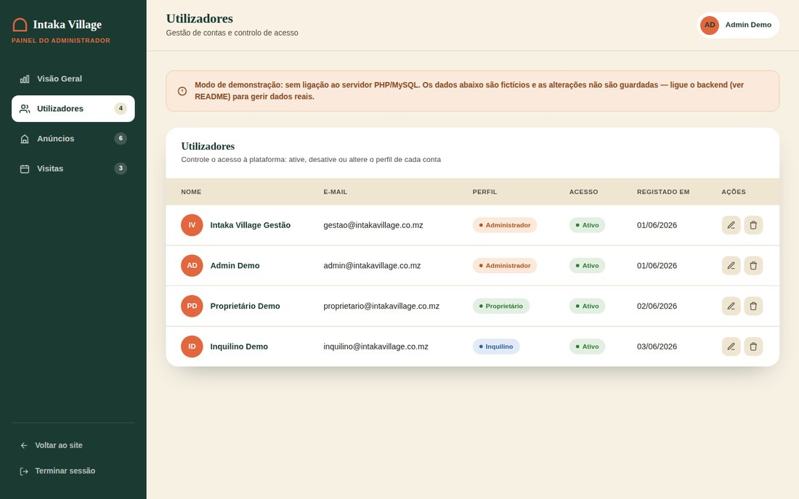

# Intaka Village — Landing Page de Agendamento de Visitas

Landing page persuasiva para agendamento de visitas a imóveis para arrendar em **Intaka Village, Maputo**, construída com a identidade visual real da marca (verde-profundo, terracota e creme, motivo do arco do portão icónico).

## Capturas de ecrã

**Página inicial** — hero, pesquisa com filtros e listagem de imóveis




**Secção de marca e FAQ**




**Login com seleção de perfil**



**Página de detalhes do imóvel** — galeria, mapa e ações de contacto




**Painel do Proprietário** — visão geral e gestão de anúncios




**Painel do Administrador** — visão geral e gestão de utilizadores




**Vista mobile**


## Stack

| Camada | Tecnologia | Função |
|---|---|---|
| Estrutura | `index.html` | Todo o conteúdo (textos, imagens, links) |
| Estilo | `css/style.css` | Design system, animações, responsividade |
| Interatividade | `js/main.js` | Filtros, carrossel, FAQ, modal, WhatsApp, chamadas à API |
| Backend | `php/` | API REST simples (imóveis + agendamento de visitas) |
| Dados | `sql/schema.sql` | Estrutura da base de dados MySQL + dados de exemplo |

## Estrutura de pastas

```
intaka-village/
├── index.html                      # página inicial (landing page)
├── detalhes.html                   # página de detalhes de um imóvel
├── proprietario.html               # painel do proprietário (anúncios, visitas, mensagens)
├── admin.html                      # painel do administrador (utilizadores, anúncios, visitas)
├── css/
│   ├── style.css                   # design system partilhado por todas as páginas
│   └── dashboard.css               # shell de aplicação dos painéis (sidebar, tabelas, KPIs)
├── js/
│   ├── common.js                   # dados + UI partilhada (cabeçalho, modal, carrossel, WhatsApp, login)
│   ├── main.js                     # lógica específica do index.html (listagem, filtros, FAQ)
│   ├── detalhes.js                 # lógica específica do detalhes.html (galeria, mapa, mensagem)
│   ├── dashboard-common.js         # navegação por secções, sidebar mobile, toast (painéis)
│   ├── proprietario.js             # CRUD de anúncios, visitas e mensagens do proprietário
│   └── admin.js                    # gestão de utilizadores e moderação da plataforma
├── php/
│   ├── config.php                  # credenciais da base de dados
│   └── api/
│       ├── imoveis.php             # GET — lista/pesquisa/detalhe de imóveis (público)
│       ├── agendar_visita.php      # POST — grava um pedido de visita
│       ├── enviar_mensagem.php     # POST — grava uma mensagem de contacto
│       ├── login.php               # POST — autentica inquilino/proprietário/admin
│       ├── gestao_imoveis.php      # CRUD de imóveis (proprietário/admin)
│       ├── gestao_visitas.php      # GET/PATCH/DELETE de visitas (proprietário/admin)
│       ├── gestao_mensagens.php    # GET/PATCH/DELETE de mensagens (proprietário)
│       └── gestao_usuarios.php     # GET/PATCH/DELETE de utilizadores (admin)
├── sql/
│   └── schema.sql                  # tabelas + dados de exemplo (seed)
└── images/                         # fotografias reais de Intaka Village
```

## Como instalar (ambiente local — XAMPP / MAMP / Laragon)

1. **Copie a pasta** `intaka-village/` para a pasta pública do seu servidor
   (`htdocs`, `www` ou equivalente).

2. **Crie a base de dados**: abra o phpMyAdmin (ou a linha de comandos do
   MySQL) e importe o ficheiro `sql/schema.sql`. Isto cria a base de dados
   `intaka_village`, todas as tabelas e insere 6 imóveis de exemplo com as
   fotografias reais da vila.

   ```bash
   mysql -u root -p < sql/schema.sql
   ```

3. **Configure a ligação**: edite `php/config.php` se as suas credenciais
   MySQL forem diferentes de `root` / sem password em `localhost`.

4. **Aceda ao site** em `http://localhost/intaka-village/index.html`
   (ajuste o caminho consoante a pasta onde colocou o projeto).

> **Nota:** se abrir apenas o `index.html` diretamente no navegador (sem
> servidor PHP), o site continua a funcionar graças a um conjunto de dados
> de reserva incorporado no `js/main.js` — mas os agendamentos de visita
> não serão guardados em nenhuma base de dados até ligar o backend PHP.

## Funcionalidades implementadas

- **Menu fixo** com scroll suave para "Sobre os Imóveis", "Detalhes", "FAQ"
  e CTA "Agendar Visita"; colapsa num menu lateral em ecrãs pequenos.
- **Login com seleção de perfil** — botão "Entrar" no cabeçalho abre um
  modal com três abas (Inquilino / Proprietário / Administrador). A
  autenticação valida as credenciais em `php/api/login.php` contra a
  tabela `usuarios` (ver credenciais de demonstração abaixo).
- **Hero** com imagem real da vila, proposta de valor e CTA principal.
- **Barra de pesquisa** com filtros por localização, tipologia (Tipo 01
  a Tipo 04, derivada do nº de quartos), preço máximo e nº de quartos —
  liga à API `php/api/imoveis.php` (com fallback local se o backend não
  estiver disponível).
- **Listagem de imóveis** dinâmica, com chips de filtro rápido (Tipo 01–04
  e Favoritos) e cartões animados (fade-in ao entrar na vista).
- **Favoritos** — o coração no topo de cada cartão adiciona/remove o
  imóvel dos favoritos, persistido no navegador (`localStorage`). O chip
  "♡ Favoritos" filtra a listagem para mostrar apenas os imóveis
  guardados, e combina-se com os restantes filtros.
- **Secção de Detalhes**: benefícios da marca + carrossel de imagens reais
  (setas, paginação, swipe em ecrãs táteis, avanço automático).
- **Faixa de urgência/escassez** antes do FAQ.
- **FAQ em acordeão** com respostas genéricas, prontas a editar.
- **Rodapé** com navegação, contactos e ícones de Facebook, Instagram e
  TikTok.
- **Popup do WhatsApp** flutuante, que surge automaticamente após alguns
  segundos e redireciona para uma conversa pré-preenchida.
- **Modal "Agendar Visita"** com validação e envio para
  `php/api/agendar_visita.php`, que grava o pedido na tabela `visitas`.

### Login — credenciais de demonstração

Semeadas em `sql/schema.sql`, para testar os três perfis:

| Perfil | E-mail | Palavra-passe |
|---|---|---|
| Inquilino | `inquilino@intakavillage.co.mz` | `Inquilino123` |
| Proprietário | `proprietario@intakavillage.co.mz` | `Proprietario123` |
| Administrador | `admin@intakavillage.co.mz` | `Admin123` |

> **Importante:** estas contas são apenas para demonstração. Altere as
> palavras-passe (ou remova as linhas) antes de publicar em produção.
> O login atual apenas valida credenciais e devolve os dados do
> utilizador — não cria sessões/cookies. Ao iniciar sessão como
> **Proprietário** ou **Administrador**, é redirecionado automaticamente
> para o respetivo painel (ver abaixo). Como **Inquilino**, permanece no
> site principal.

#### Como criar novas contas manualmente (sem formulário de registo)

Como o projeto ainda não tem um formulário de registo, a forma mais
simples de criar uma conta de teste é inserir uma linha na tabela
`usuarios` pelo phpMyAdmin. O campo `senha_hash` aceita **dois
formatos**, para facilitar:

- **Texto simples** — escreva a palavra-passe tal como quer que o
  utilizador a digite (ex.: `MinhaSenha123`). O login reconhece que não
  é um hash bcrypt e compara diretamente.
- **Hash bcrypt** — se preferir a forma mais segura, gere o hash com
  `php -r "echo password_hash('MinhaSenha123', PASSWORD_DEFAULT);"` e
  cole o resultado (começa por `$2y$`) na coluna `senha_hash`.

Nos dois casos, o utilizador faz login normalmente com a palavra-passe
que foi definida (nunca com o próprio hash). As mensagens de erro do
login também identificam especificamente qual campo está incorreto:
"E-mail incorreto.", "Senha incorreta." ou, se as credenciais
estiverem certas mas o separador de perfil (Inquilino/Proprietário/
Administrador) escolhido não corresponder à conta, "Esta conta não
está registada como [perfil]."

> **Nota de segurança:** guardar palavras-passe em texto simples é
> cómodo para testes, mas não é recomendado para um sistema em
> produção com dados reais — qualquer pessoa com acesso à base de
> dados consegue ler as senhas diretamente. Prefira sempre o formato
> bcrypt (hash) assim que o projeto tiver um formulário de registo
> que o gere automaticamente.

### Painel do Proprietário (`proprietario.html`)

Acedido após login com o perfil "Proprietário" (ou diretamente pelo
URL). Permite:

- **Visão Geral** — KPIs (total de anúncios, disponíveis, visitas
  pendentes, mensagens não lidas) e as 5 próximas visitas agendadas.
- **Meus Anúncios** — criar novos anúncios ("+ Novo Anúncio"), editar
  qualquer imóvel existente, mudar o estado diretamente na tabela
  (Disponível / Reservado / Arrendado-Ocupado) e eliminar anúncios.
  Ligado a `php/api/gestao_imoveis.php` (CRUD completo).
- **Visitas Agendadas** — consultar, mudar o estado (Pendente /
  Confirmada / Concluída / Cancelada) e eliminar pedidos de visita.
  Ligado a `php/api/gestao_visitas.php`.
- **Mensagens** — ver mensagens recebidas através dos anúncios, marcar
  como lida/não lida e eliminar. Ligado a `php/api/gestao_mensagens.php`.

### Painel do Administrador (`admin.html`)

Acedido após login com o perfil "Administrador". Permite:

- **Visão Geral** — KPIs da plataforma e distribuição de utilizadores
  por perfil.
- **Utilizadores** — controlo de acesso: ativar/desativar contas, mudar
  o perfil (Inquilino/Proprietário/Administrador) e eliminar
  utilizadores. Ligado a `php/api/gestao_usuarios.php`.
- **Anúncios** — moderação de todos os imóveis da plataforma (mudar
  estado ou remover), independentemente do proprietário.
- **Visitas** — vista de todas as visitas agendadas em qualquer anúncio
  da plataforma.

### Modo de demonstração dos painéis

Tal como o resto do site, ambos os painéis funcionam mesmo sem servidor
PHP/MySQL ativo: se a API não responder, aparece um aviso amarelo
("Modo de demonstração") e os dados fictícios ficam apenas em memória
do navegador — todas as ações (criar, editar, mudar estado, eliminar)
continuam a funcionar visualmente, mas não persistem ao recarregar a
página. Ligue o backend para gerir dados reais.

> **Nota sobre autenticação e permissões:** esta é uma landing page com
> autenticação leve (sem sessões/cookies). Por isso, `gestao_imoveis.php`
> não filtra anúncios por proprietário autenticado — o painel do
> proprietário mostra todos os imóveis da base de dados (que, nos dados
> de exemplo, pertencem todos ao mesmo utilizador semeado). Antes de
> produção, implemente sessões (RNF9 do levantamento de requisitos) e
> restrinja cada proprietário aos seus próprios anúncios.

### Página de detalhes do imóvel (`detalhes.html`)

Acedida a partir de qualquer cartão do index (`detalhes.html?id=X`), esta
página traz:

- **Navegação de regresso**: logótipo, menu e o link "← Voltar aos
  imóveis" apontam sempre para `index.html`, além de um breadcrumb com o
  nome do imóvel atual.
- **Galeria de imagens** (reutiliza o componente de carrossel do
  `common.js`) com setas, paginação e swipe em ecrãs táteis.
- **Ficha técnica**: tipologia, preço, quartos, casas de banho, área,
  descrição completa e lista de comodidades.
- **Mapa de localização** com [Leaflet](https://leafletjs.com/) +
  OpenStreetMap (gratuito, sem chave de API), carregado via CDN. Requer
  ligação à internet no browser do visitante; sem rede, mostra
  automaticamente um aviso e um link "Abrir no Google Maps" como
  alternativa.
- **Sidebar fixa** com preço, botão "Agendar Visita" (abre o mesmo modal
  partilhado, já com o imóvel pré-selecionado) e "Enviar Mensagem".
- **Formulário de mensagem** próprio, que grava em `php/api/enviar_mensagem.php`
  → tabela `mensagens`.
- **Imóveis semelhantes** sugeridos no final da página.

Se o imóvel pedido não existir (ex.: `?id=999`), a página mostra um
estado "Não encontrámos este imóvel" com um botão para voltar à listagem.

## Personalização rápida

- **Número de WhatsApp**: altere `WHATSAPP_NUMERO` em `php/config.php` e
  a constante `WHATSAPP_NUMERO` no topo de `js/main.js`, além dos links
  `https://wa.me/258840000000` no `index.html`.
- **Imóveis**: edite ou adicione linhas na tabela `imoveis` (e
  `imovel_imagens` para a galeria) em vez de mexer no HTML — a página lê
  tudo dinamicamente via API.
- **Cores e tipografia**: todas as variáveis estão centralizadas no topo
  de `css/style.css` (`:root`), incluindo a paleta de marca e as fontes
  Fraunces/Manrope.
- **Perguntas do FAQ**: estão diretamente no `index.html`, dentro da
  secção `<section id="faq">` — cada pergunta é um bloco `.faq-item`
  independente.

## Próximos passos sugeridos (fora do âmbito desta landing page)

O documento de requisitos fornecido descreve um sistema mais amplo
(inquilino / proprietário / administrador, mensagens, favoritos). O
schema em `sql/schema.sql` já inclui as tabelas `usuarios`, `mensagens`
e `favoritos` prontas para essa evolução, caso o projeto cresça para uma
aplicação completa com login e áreas reservadas.
